

PES UNIVERSITY

Department of Computer Science and Engineering · RR Campus

UE24CS352A: Machine Learning

<h1 class="title">PathSnap</h1>

Distributed Map-Matching &amp; Route Reconstruction

Technical Report · Hackathon Final Submission

<table class="team">
<tr><th colspan="2">Team 26</th></tr>
<tr><td>Aryan Shashank Musale</td><td>PES1UG24CS085</td></tr>
<tr><td>Aryan Singh</td><td>PES1UG24CS086</td></tr>
<tr><td>Bharat V Bhat</td><td>PES1UG24CS113</td></tr>
<tr><td>Bharath Hegde</td><td>PES1UG24CS114</td></tr>
</table>

Repository: <b>https://github.com/Musaleee/PathSnap-ML-Hackathon</b>

18 November 2026

**Summary of results**

| Stage (same evaluation points) | Student-test Top-1 | Evaluator-test Top-1 | Route F1 (student / evaluator) |
|---|---|---|---|
| Rule baseline: nearest road | 0.572 | 0.508 | – |
| Rule baseline: nearest road in direction of travel | 0.890 | 0.864 | – |
| Best untuned classifier (HistGradientBoosting) | 0.933 | 0.948 | – |
| Tuned HistGB (Bayesian optimisation), classifier only | 0.937 | 0.928 | 0.824 / – |
| **Final system: tuned HistGB + HMM/Viterbi** | **0.952** | **0.962** | **0.968 / 0.953** |

The final system matches about **96 % of GPS observations to the correct road segment** on the ten held-out evaluator trips and reconstructs routes with a route F1 of 0.95. It runs end-to-end in under one second per trip on a FastAPI server (Laptop 1) and is operated through a web UI (Laptop 2).

**Contents**

1. Introduction and system overview
2. Dataset understanding and exploratory data analysis
3. Model experimentation and comparison
4. Bayesian hyperparameter optimisation
5. HMM and Viterbi route reconstruction
6. Geographical visualisation using Folium
7. API, UI and deployment
8. Final evaluation on the evaluator-test trips
9. Limitations and future work
10. Reproducibility, repository and AI-use disclosure

# 1. Introduction and system overview

GPS receivers in vehicles are noisy: buildings, multipath and dropouts make a car appear on a parallel street or jump across blocks. **PathSnap** takes a trip's raw GPS observations and the trip's directed road network and decides, for every observation, which road segment (arc) the vehicle was actually on, then reconstructs a connected, drivable route.

**Pipeline**

1. **Pre-processing:** load and validate the files, project coordinates to metres (per-trip UTM zone).
2. **Candidate generation:** for every GPS point, all arcs within 50 m (at most 12), found with a KD-tree.
3. **Feature engineering:** 24 features for each (GPS point, candidate arc) pair.
4. **Classification:** a supervised model estimates P(candidate is the true arc). Seven models were compared; HistGradientBoosting was selected and tuned with Bayesian optimisation.
5. **Sequential decoding:** an HMM over the candidates, decoded with Viterbi, enforces road-network connectivity.
6. **Route reconstruction:** consecutive chosen arcs are joined with real shortest paths in the directed network.
7. **Deployment:** FastAPI backend (Laptop 1) and a browser UI (Laptop 2). Ground truth never leaves the server.

**Data partitions and how they were used**

| Partition | Trips | GPS points | Used for |
|---|---|---|---|
| Train | 80 | 208,417 | EDA, fitting, 5-fold grouped cross-validation, Bayesian tuning, HMM parameter selection |
| Student-test | 10 | 19,160 | Development comparisons (each model evaluated once after CV) |
| Evaluator-test | 10 | 19,674 | Final test only; never used for any choice (Section 8) |

**Primary metric (declared before comparing models).** *Observation-level Top-1 accuracy*: for each GPS point the highest-scoring candidate is compared with the reference arc. It is computed over *evaluable* points (reference label is trustworthy and the reference arc is among the candidates). Tie-break: candidate log loss, because the probabilities feed the HMM.

# 2. Dataset understanding and exploratory data analysis

## 2.1 The data

Each trip folder contains four whitespace-separated files without headers:

| File | Columns | Meaning |
|---|---|---|
| `.track` | lon, lat, t | GPS observations, t in seconds |
| `.nodes` | lon, lat | Road-network nodes; row index = node id |
| `.arcs` | u, v | Directed road segments u → v; row index = arc id |
| `.route` | arc id | Ordered sequence of reference arcs actually driven |

Node and arc ids are **local to each trip**, so every cache key includes the trip id. The `.route` file is a sequence of arcs, **not** one label per GPS point: row *i* of `.track` has no relation to row *i* of `.route`.

**Size.** Trips have 262–19,313 GPS points (median ≈ 1,500). Road networks have 299–155,003 nodes and 649–307,392 arcs per trip. Reference routes are 59–2,266 arcs long. The trips are **worldwide**: 58 in Europe/Africa, 11 in the Americas and 21 further east (Russia, Central and East Asia).

## 2.2 How we pre-processed the data

1. **Loading and invariant checks (all 90 trips, train + student-test).** We checked that coordinates are finite and in range, timestamps are increasing, arc endpoints are valid node ids, route ids are valid arc ids, and recorded self-loops, reciprocal arcs and connectivity of consecutive route arcs. Problems are logged, never silently deleted (`experiments/results/data_quality_summary.txt`).
2. **Projection to metres.** Latitude/longitude are angles, so distances in degrees are wrong. We first planned one fixed UTM zone (32N), but it produced non-finite coordinates for trip 00000057 (Ecuador). Because the data is worldwide, **each trip is projected into its own UTM zone**, chosen from its median GPS position (pyproj).
3. **Reference label per GPS point (label alignment).** Because `.route` does not say which GPS point belongs to which arc, we built the labels ourselves and compared two strategies:
    - *Nearest route arc* (baseline): each point takes the closest arc of the route. Simple, but it ignores time order and fails at U-turns and roads driven twice.
    - *Order-preserving alignment* (chosen): dynamic programming assigns points to route arcs so that the position along the route never moves backwards, minimising the total point-to-arc distance.

    The two agree on 93.4 % of train points and 89.7 % of student-test points. A point is flagged **ambiguous** when its aligned arc is more than 30 m away **or** the two strategies disagree: 17.9 % of train points and 10.8 % of student-test points. Ambiguous points are excluded from training and from Top-1, so the model does not learn from labels we do not trust.

4. **Candidate generation.** All arcs are densified every 10 m and stored in a KD-tree; for each GPS point the arcs within 50 m (maximum 12, nearest first) become candidates. This avoids comparing every point with millions of arcs. Result for train: 1,342,864 (point, candidate) rows, ≈ 6.4 per point, 13.7 % positive. **Candidate miss rate** (reference arc not among the candidates) on evaluable points: **0.001 on train and 0.000 on student-test**.

5. **Training table.** One row per (point, candidate) with the 24 features, label 1 if the candidate is the aligned reference arc, and the ambiguity flag. Missing values (heading undefined when stopped) are imputed **inside each CV fold** (median plus missing-indicator); HistGradientBoosting handles them natively.

## 2.3 Missing-value analysis and data quality (train and student-test)

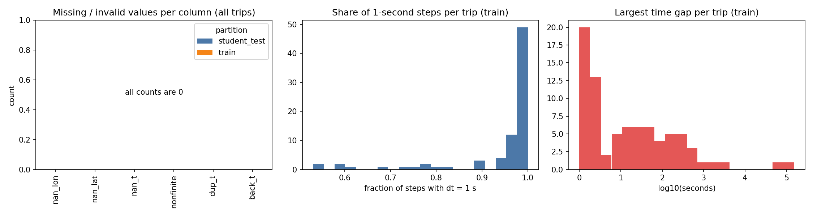

| Check | Train (80 trips) | Student-test (10 trips) |
|---|---|---|
| Missing or non-finite lon / lat / t | **0** | **0** |
| Duplicate timestamps / backwards timestamps | 0 / 0 | 0 / 0 |
| Time gaps longer than 10 s | 590 | 27 |
| Share of 1-second steps (mean per trip) | 0.938 | 0.982 |
| Trips containing self-loop arcs | 8 | 1 |

Across all 90 trips, 96.7 % of time steps are exactly 1 s (point-weighted), 42 trips contain at least one gap longer than 10 s, 95.1 % of arcs (median per trip) have a reciprocal arc in the opposite direction, and only 14 of 34,723 consecutive reference-route steps are not connected in the network.

## 2.4 Patterns observed

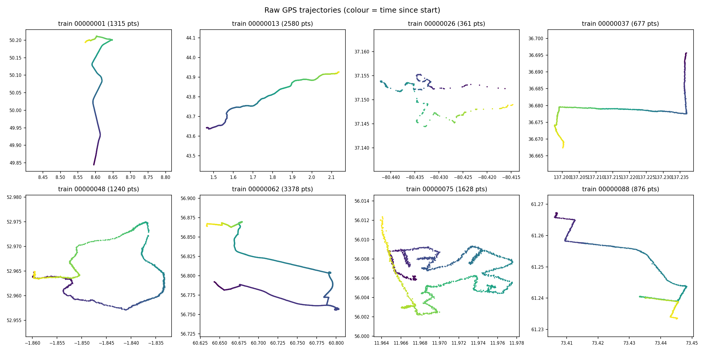

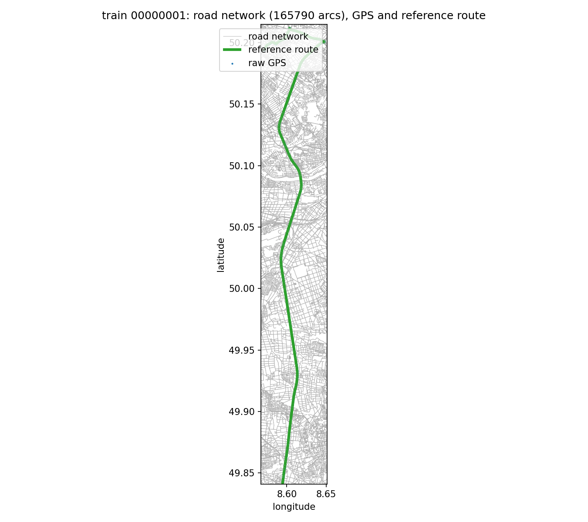

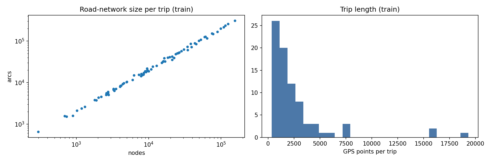

- **Roads come in pairs.** About 95 % of roads exist as two arcs in opposite directions at exactly the same place, so distance alone cannot separate them; the **direction of travel** is essential.
- **GPS is dense but noisy.** One reading per second, typically 5–30 m off the road, with occasional long gaps (up to hours).
- **Large, worldwide networks.** The trip's network covers a far larger area than the trip, so efficient candidate search is necessary.
- **Hard cases exist.** Trip 00000054 has a systematic 80–110 m offset from every road after point 2,710 (these points become ambiguous). Trips 00000011, 00000061, 00000065 and 00000077 have low agreement between the two labelling strategies (U-turns and revisited roads).

A Folium map of the raw data (train trip 00000001: GPS, road network near the track and reference route) is in `maps/eda_train_00000001.html`; further maps are in Section 6.

## 2.5 Features extracted and why

None of the 24 features uses `.route`, so they are identical at training and inference time.

| Group | Features | Why we chose them |
|---|---|---|
| Distance | `dist`, `dist_rank`, `dist_minus_min`, `dist_ratio_min`, `n_cand` | The true arc is usually close; *relative* distance to the other candidates is more stable than absolute distance when GPS noise changes |
| Position on arc | `frac_along`, `seg_len` | A projection at the very end of an arc often means the next arc is correct |
| Direction | `heading_diff`, `heading_cos`, `heading_diff_rev` | Vehicle heading vs. the **directed** arc bearing separates the two opposite arcs of a road; set to missing when speed < 1 m/s |
| Kinematics | `speed`, `dt_prev`, `dt_next`, `moving` | Heading is unreliable when stopped or across time gaps |
| Temporal window (±3 points) | `win_mean_dist`, `win_max_dist`, `win_mean_heading_diff` | One noisy point should not decide; the right arc fits the whole neighbourhood |
| Continuity / network | `in_prev_cands`, `in_next_cands`, `connected_prev_best`, `connected_next_best`, `out_deg_v`, `in_deg_u`, `has_reverse` | Vehicles drive on connected roads; junction complexity; one-way vs two-way |

**Which features mattered** (permutation importance, HistGB, student-test; drop in Top-1 when the feature is shuffled, baseline 0.933):

| Feature | Top-1 drop |
|---|---|
| `win_mean_heading_diff` | 0.352 |
| `frac_along` | 0.092 |
| `heading_diff` | 0.037 |
| `dist_minus_min` | 0.021 |
| `dist` | 0.020 |
| `speed` | 0.016 |

Direction agreement over the neighbouring points dominates. The rule baselines confirm it: choosing the nearest road gives Top-1 0.572 on student-test, choosing the nearest road *in the direction of travel* gives 0.890, and the learned model reaches 0.933 by also using context.

# 3. Model experimentation and comparison

**Set-up.** Binary classification of (point, candidate) pairs; the highest-probability candidate per point is the prediction. Every model is a scikit-learn pipeline (imputation and scaling fitted inside each fold). Cross-validation: **GroupKFold(5) over trip ids** on the 80 train trips, so a trip is never split between training and validation. After CV each model is refitted on all 80 trips and evaluated **once** on the 10 student-test trips. Training uses non-ambiguous points only; seed 42. Fold membership, parameters and metrics of every run are logged in `experiments/logs/*.json`.

**Metric definitions.** *Top-1*: observation level (Section 1). *Macro-F1*: candidate-pair level, mean F1 over the two classes {correct arc, wrong arc} at threshold 0.5. *Log loss*: candidate-pair level. *Route continuity*: share of consecutive observations whose chosen arcs are the same arc or share a node. *Inference time*: model prediction time per student-test trip.

## 3.1 Overall model comparison

| Model | Algorithm family | Key configuration | CV macro-F1 | CV Top-1 | CV route continuity | Student-test Top-1 | Student-test macro-F1 | Student-test log loss | Inference (s/trip) |
|---|---|---|---|---|---|---|---|---|---|
| HistGradientBoosting | Boosting | 300 iter., lr 0.1, 31 leaves, early stopping | 0.9545 ± 0.008 | 0.9301 ± 0.015 | 0.9683 | **0.9331** | 0.9555 | 0.0523 | 0.008 |
| Random Forest | Ensemble (bagging) | 150 trees, depth 18, min leaf 5, 30 % bootstrap | 0.9531 ± 0.007 | 0.9295 ± 0.012 | 0.9646 | 0.9319 | **0.9559** | **0.0500** | 0.018 |
| MLP | Neural network | 64-32 ReLU, Adam, α 1e-4, early stopping; 400k-row sample | 0.9521 ± 0.007 | **0.9310** ± 0.010 | **0.9694** | 0.9274 | 0.9509 | 0.0555 | 0.006 |
| Extra Trees | Ensemble (randomised trees) | 150 trees, depth 18, min leaf 5 | 0.9460 ± 0.007 | 0.9248 ± 0.012 | 0.9654 | 0.9209 | 0.9472 | 0.0674 | 0.028 |
| Logistic Regression | Linear | L2, C = 1.0, lbfgs | 0.9266 ± 0.008 | 0.9184 ± 0.010 | 0.9535 | 0.9073 | 0.9296 | 0.0864 | 0.003 |
| KNN | Instance-based | k = 25, distance-weighted; 150k-row sample | 0.9333 ± 0.006 | 0.9114 ± 0.011 | 0.9684 | 0.9073 | 0.9357 | 0.0955 | 1.579 |
| Gaussian Naive Bayes | Probabilistic | var_smoothing 1e-9 | 0.8624 ± 0.012 | 0.8987 ± 0.011 | 0.9679 | 0.8981 | 0.8552 | 0.7092 | 0.005 |

Student-test precision / recall / F1 of the positive class (threshold 0.5):

| Model | Precision | Recall | F1 | Train time (s) |
|---|---|---|---|---|
| HistGradientBoosting | 0.916 | 0.930 | 0.923 | 4.0 |
| Random Forest | 0.940 | 0.908 | 0.924 | 25.9 |
| MLP | 0.925 | 0.905 | 0.915 | 6.2 |
| Extra Trees | 0.943 | 0.876 | 0.908 | 9.9 |
| Logistic Regression | 0.868 | 0.889 | 0.879 | 3.0 |
| KNN | 0.901 | 0.876 | 0.889 | 0.3 |
| Gaussian Naive Bayes | 0.639 | 0.934 | 0.759 | 2.2 |

**Model selection.** The three best models (HistGB, Random Forest, MLP) are within one fold standard deviation of each other on CV Top-1, so we did not choose on CV Top-1 alone. **HistGradientBoosting** was selected because it had (1) the best student-test Top-1, (2) near-best log loss, i.e. well-calibrated probabilities for the HMM emissions, (3) the fastest training (4 s vs 26 s for Random Forest), which makes Bayesian optimisation affordable, and (4) native handling of the missing heading values.

## 3.2 Per-model analysis

### 3.2.1 Logistic Regression (linear)

**A. Understanding.** (1) It tests whether a linear decision boundary over our features is enough, gives probabilities directly and is fast, which makes it the natural baseline. (2) *Strengths:* fast (3 s training, 0.003 s/trip), interpretable coefficients, reasonable calibration. *Limitations:* cannot represent interactions such as "close **and** same direction **and** consistent with neighbours"; needs scaling and imputation.

**B. Training.** (5) C = 1.0 (L2 penalty), solver lbfgs, max_iter 500; median imputation with missing indicators and standard scaling. (6) Objective: regularised binary cross-entropy (log loss + L2 penalty).

**C. Results.** (7–8) Student-test Top-1 **0.9073**, macro-F1 **0.9296**, log loss **0.0864**. (9) **Underfitting**, not overfitting: CV Top-1 0.9184 and student-test 0.9073 are both about 1.3–2.5 points below the tree models, and the training and test scores are close, so the limitation is model capacity (linear boundary), not memorisation.

### 3.2.2 Gaussian Naive Bayes (probabilistic)

**A. Understanding.** (1) A very fast generative baseline that shows what happens if features are treated as independent given the class. (2) *Strengths:* trains in 2 s, no tuning. *Limitations:* the independence assumption is clearly violated here (`dist`, `win_mean_dist` and `dist_rank` are strongly correlated), which makes the probabilities over-confident.

**B. Training.** (5) var_smoothing = 1e-9, with median imputation and scaling. (6) Objective: maximum likelihood of one Gaussian per feature and class.

**C. Results.** (7–8) Student-test Top-1 **0.8981**, macro-F1 **0.8552**, log loss **0.7092**. Its *ranking* of candidates is acceptable (Top-1 ≈ 0.90), but precision is only 0.639 and log loss is more than 10× that of the tree models. (9) **Underfitting:** CV 0.8987 ≈ student-test 0.8981, so there is no overfitting; the poor results come from the wrong independence assumption.

### 3.2.3 K-Nearest Neighbours (instance-based)

**A. Understanding.** (1) Non-parametric: a candidate is judged by similar candidates in feature space, with no assumption about the shape of the boundary. (2) *Strengths:* flexible boundary, no training cost. *Limitations:* sensitive to feature scaling and dimensionality (24+ features), memory-heavy, and slow at prediction time.

**B. Training.** (5) k = 25, distance-weighted votes, Euclidean distance on standardised features; trained on a seeded 150,000-row subsample of the 1.1 M non-ambiguous training rows (full data would make prediction too slow). (6) No loss is optimised (lazy learner); the prediction is the distance-weighted share of positive neighbours.

**C. Results.** (7–8) Student-test Top-1 **0.9073**, macro-F1 **0.9357**, log loss **0.0955**; inference **1.58 s per trip**, about 200× slower than the tree models. (9) Small gap between CV 0.9114 and student-test 0.9073, so no strong overfitting; performance is limited by the subsample and by the curse of dimensionality.

### 3.2.4 Random Forest (bagging ensemble)

**A. Understanding.** (1) Many decision trees on bootstrap samples learn non-linear rules such as the AND-combinations of distance, direction and context that this task needs, and averaging gives good probabilities. (2) *Strengths:* robust, no scaling needed, best log loss (0.050). *Limitations:* large model (83 MB), slower training (26 s) and inference (0.018 s/trip).

**B. Training.** (5) 150 trees, max_depth 18, min_samples_leaf 5, each tree on a 30 % bootstrap sample, √(number of features) considered at each split (default). (6) Objective: Gini impurity reduction at each split.

**C. Results.** (7–8) Student-test Top-1 **0.9319**, macro-F1 **0.9559** (best), log loss **0.0500** (best). (9) **No overfitting:** CV 0.9295 vs student-test 0.9319; the depth and leaf-size limits regularise the trees.

### 3.2.5 Extra Trees (randomised trees)

**A. Understanding.** (1) Like Random Forest but with random split thresholds, which lowers variance and speeds up training. (2) *Strengths:* fast to train, stable. *Limitations:* the extra randomness costs accuracy on this task (recall 0.876).

**B. Training.** (5) 150 trees, max_depth 18, min_samples_leaf 5, bootstrap with 30 % samples. (6) Objective: Gini impurity with random thresholds.

**C. Results.** (7–8) Student-test Top-1 **0.9209**, macro-F1 **0.9472**, log loss **0.0674**. (9) CV 0.9248 vs student-test 0.9209: no overfitting; it slightly **underfits** compared with Random Forest because of the random splits.

### 3.2.6 HistGradientBoosting (boosting): selected model

**A. Understanding.** (1) Gradient boosting builds trees one after another, each correcting the errors of the previous ones, on binned features. It captures the non-linear interactions, handles missing headings natively and produces good probabilities for the HMM. (2) *Strengths:* best student-test Top-1, near-best log loss, very fast (4 s training, 0.008 s/trip). *Limitations:* more hyperparameters to tune; larger configurations can overfit (see Section 8).

**B. Training.** (5) Initial values: max_iter 300, learning_rate 0.1, max_leaf_nodes 31, min_samples_leaf 20, no L2 regularisation, early stopping on a 10 % validation split (stopped after 99 iterations in the final fit). (6) Objective: binary log loss (cross-entropy).

**C. Results.** (7–8) Student-test Top-1 **0.9331** (best), macro-F1 **0.9555**, log loss **0.0523**. (9) **No overfitting:** CV 0.9301 ± 0.015 vs student-test 0.9331. The training history (figure below) shows the validation loss flattening and early stopping before it rises: training loss 0.412 → 0.198, validation loss 0.178 at the stopping point.

### 3.2.7 Multi-layer Perceptron (neural network)

**A. Understanding.** (1) A neural network can learn arbitrary feature interactions and gives probabilities. (2) *Strengths:* best CV Top-1 (0.9310), fast inference. *Limitations:* needs scaling and imputation, training is less stable, and it was trained on a subsample.

**B. Training.** (5) Hidden layers (64, 32), ReLU, Adam, L2 α = 1e-4, batch size 1024, max 40 epochs with early stopping (patience 5) on a 10 % validation split; seeded 400,000-row subsample. (6) Objective: binary cross-entropy.

**C. Results.** (7–8) Student-test Top-1 **0.9274**, macro-F1 **0.9509**, log loss **0.0555**. (9) Slight **overfitting / variance**: it has the best CV Top-1 but the lowest student-test Top-1 of the top three (−0.0036 gap). The training history shows training loss falling from 0.132 to 0.053 over 21 epochs while validation accuracy plateaus at 0.979, after which early stopping ended training.

## 3.3 Model visualisations

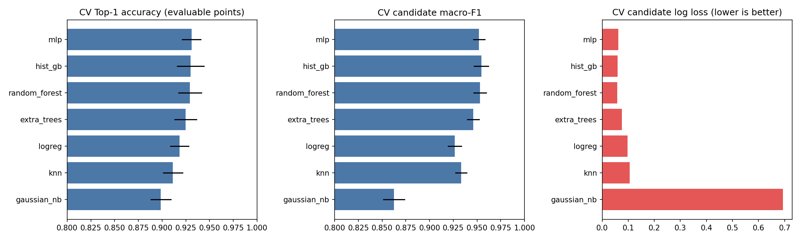

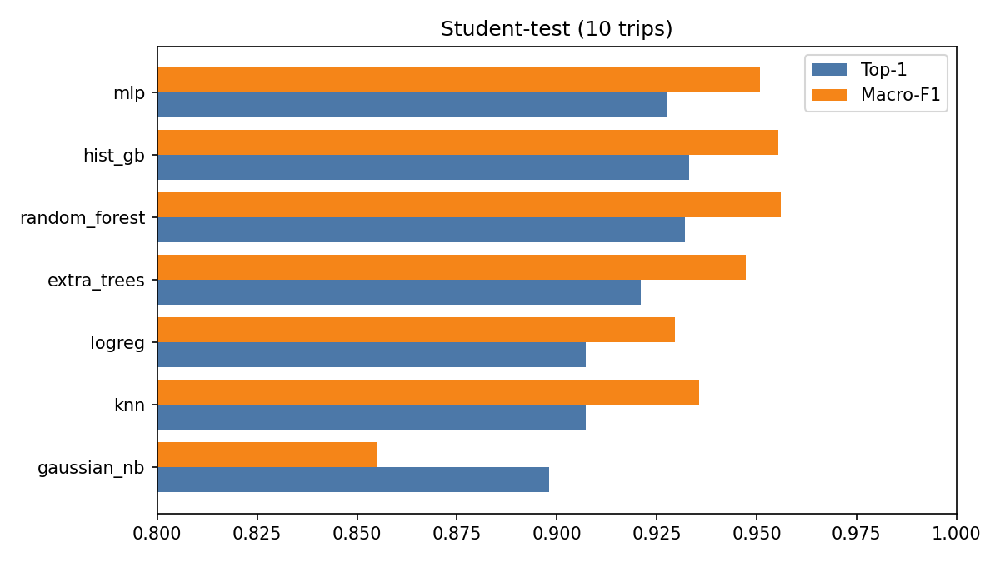

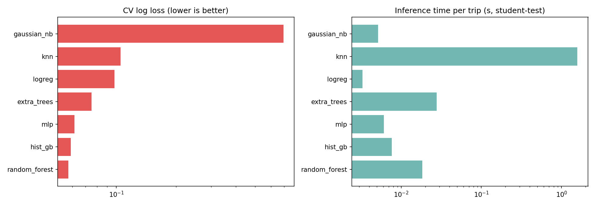

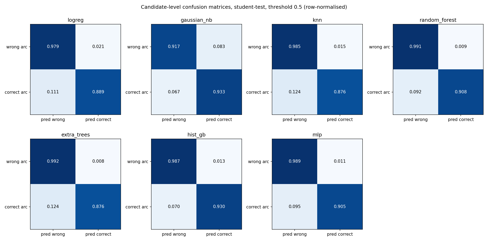

Training and validation curves are shown **only** for the two models that produce real iteration histories (HistGradientBoosting and MLP). Logistic Regression, Naive Bayes, KNN, Random Forest and Extra Trees do not train epoch by epoch, so no curves exist for them.

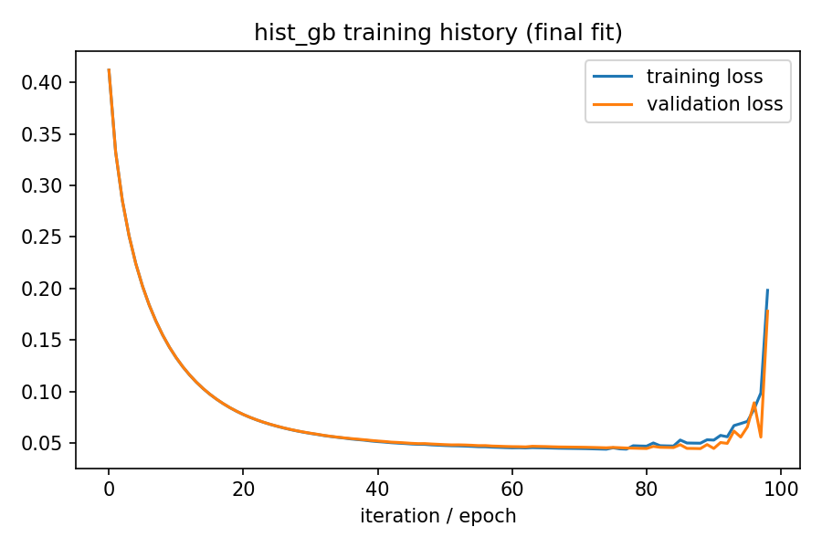

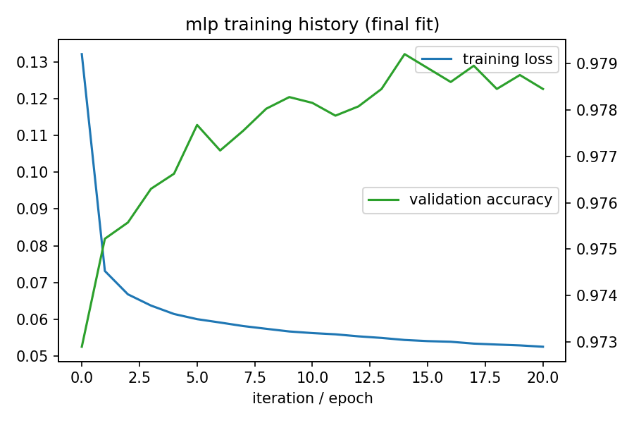

# 4. Bayesian hyperparameter optimisation (HistGradientBoosting)

1. **Hyperparameters searched and 2. ranges** (centred on the untuned defaults):

| Hyperparameter | Range / distribution | Untuned value | Best value |
|---|---|---|---|
| learning_rate | 0.02 – 0.3, log-uniform | 0.1 | **0.097** |
| max_leaf_nodes | 15 – 255, log-uniform integer | 31 | **239** |
| max_depth | {None, 6, 10, 16} | None | **None** |
| min_samples_leaf | 10 – 1000, log-uniform integer | 20 | **14** |
| l2_regularization | 1e-4 – 10, log-uniform | 0 | **0.99** |
| max_features | 0.5 – 1.0, uniform | 1.0 | **0.63** |
| max_iter | 150 – 800, step 50 | 300 | **500** |

3. **Objective:** maximise the mean **GroupKFold(5) cross-validated Top-1** on evaluable points of the 80 train trips (the primary metric). Sampler: Optuna **TPE** (Tree-structured Parzen Estimator, seed 42, 10 random start-up trials), with a median pruner. Trial 0 was the untuned configuration, so the search started from the baseline. Student-test was used only once, after the search; the evaluator-test data was never used.
4. **Trials:** **20 completed trials** (none pruned; a 21st trial was interrupted by us and is recorded as failed). We stopped at 20 because the best value improved by only 0.001 over the last 15 trials, less than the fold standard deviation (≈ 0.015–0.019). Search time: **37 minutes** (≈ 1.9 min per trial, five model fits each).
5. **Best values:** shown in the table above (`experiments/optuna/best_params.json`).
6. **Did the tuned model outperform the untuned one?** Yes on every accuracy metric (same folds, same partitions):

| Metric | Untuned | Tuned |
|---|---|---|
| CV Top-1 | 0.9301 ± 0.015 | **0.9369** ± 0.019 |
| CV macro-F1 | 0.9545 | **0.9561** |
| Student-test Top-1 | 0.9331 | **0.9373** |
| Student-test macro-F1 | 0.9555 | **0.9595** |
| Student-test log loss | 0.0523 | **0.0510** |
| CV log loss | **0.0589** | 0.0609 |
| Inference time (s/trip) | **0.010** | 0.061 |
| Training time (s) | **5** | 47 |

The gain is small but consistent; the price is a larger, slower model (239 leaves, 500 trees). Most of the gain was found in the first good trial (figure below).

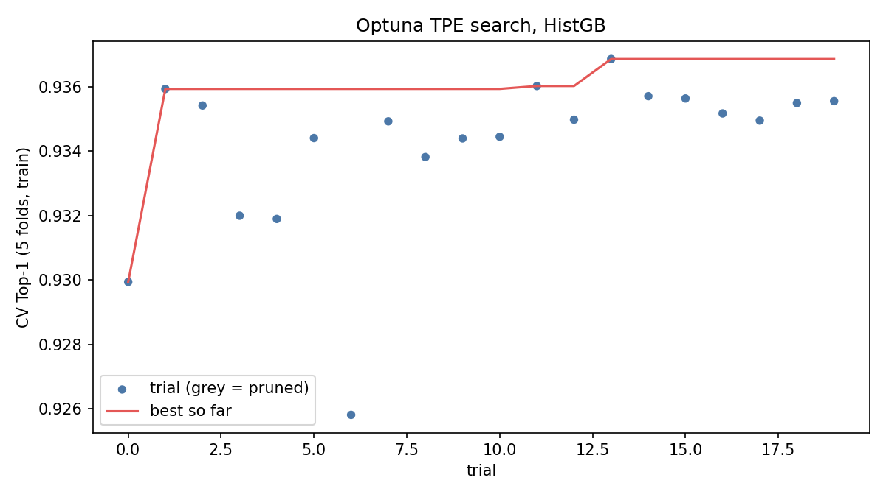

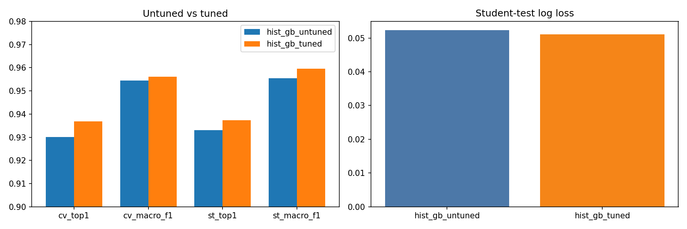

# 5. HMM and Viterbi route reconstruction

Independent per-point predictions can produce an impossible route, e.g. two consecutive observations on arcs that are not connected. The HMM uses the sequence and the road network to choose the most likely *connected* sequence of arcs.

1. **Hidden states.** At observation *t* the states are the candidate arcs of that GPS point (the same candidates the classifier scored). Each state keeps its arc id, so the candidate-to-road-segment correspondence is preserved; the decoder returns one arc per observation.
2. **Emission probabilities.** From the selected classifier: *log P(zt | s) = w · log( p(s) / Σ p )*, where *p(s)* is the tuned HistGB probability of candidate *s*, normalised over the point's candidates, and *w* is an emission weight.
3. **Transition probabilities.** *log P(st | st-1) = −| droute − dgc | / β*. Here *droute* is the driving distance along the **directed** network from the projected position on the previous arc to the projected position on the next arc (bounded Dijkstra, search bound 2·dgc + 200 m, at most 5 km), and *dgc* is the straight-line distance between the two GPS points. On the same arc, forward movement is used directly and up to 15 m backwards is accepted as GPS noise. Arcs not reachable within the bound get probability 0 (log = −∞). Decoding uses the **Viterbi recurrence** in log space: *δt(s) = et(s) + maxs' [δt-1(s') + a(s', s)]*, with back-pointers to recover the best path.
4. **Missing candidates and large gaps.** Points with no candidate within 50 m have no state; they get no prediction and the chain continues across them. A time gap longer than **60 s** restarts the chain (decoding starts again from the emissions). Shorter gaps widen the search bound automatically through *dgc*.
5. **Disconnected segments.** If no transition from the previous candidates is possible, the chain is broken and restarted at that point, and the break is counted. In route reconstruction, consecutive chosen arcs are joined with the shortest directed path; if none exists within the bound, a gap is inserted. **Connectivity is never invented.**
6. **Did HMM decoding improve the route?** The decoder parameters were chosen by a grid search on **train out-of-fold** predictions (β ∈ {2, 5, 10, 20, 50} m, w ∈ {0.5, 1, 2}); the best was **β = 5 m, w = 0.5**. Every grid setting beat classifier-only on train. Student-test was consulted once:

| Partition | Decoder | Top-1 | Route continuity | Route precision | Route recall | Route F1 | Norm. edit distance |
|---|---|---|---|---|---|---|---|
| Student-test | Classifier only | 0.9373 | 0.972 | 0.714 | 0.993 | 0.824 | 0.576 |
| Student-test | **Classifier + HMM** | **0.9515** | **0.984** | **0.947** | 0.991 | **0.968** | **0.099** |
| Train (out-of-fold) | Classifier only | 0.9331 | 0.973 | 0.693 | 0.984 | 0.797 | 0.512 |
| Train (out-of-fold) | **Classifier + HMM** | **0.9496** | **0.986** | **0.932** | 0.987 | **0.957** | **0.131** |

*Route precision / recall* compare the set of arcs in the reconstructed route with the reference route; *normalised edit distance* is the Levenshtein distance between the collapsed arc sequences divided by the longer length (lower is better).

**Interpretation.** Without the HMM the route already contains almost all of the right roads (recall 0.99) but also many spurious jumps (precision 0.71), because each point is decided independently. The HMM removes those jumps: precision rises to 0.95, edit distance falls from 0.58 to 0.10, and Top-1 improves by 1.4 points. Decoding costs about 0.02 s per trip.

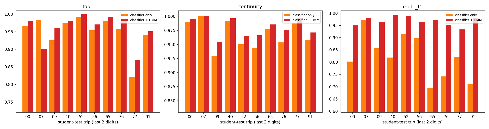

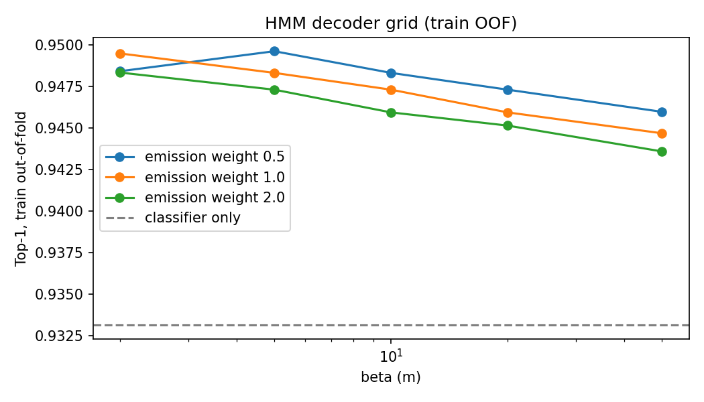

**Where the HMM did not help.** On student-test trip **00000007**, Top-1 fell from 0.983 to 0.901 (route F1 still rose from 0.972 to 0.980). At a fork two arcs leave the same node (20 → 89 and 20 → 1386). The HMM committed to the wrong branch for about 140 consecutive observations (points 1,208–1,353), because the branch whose length better matched the GPS distances won the transition term, while the classifier alone had chosen correctly point by point. On evaluator trip 00000094 the HMM was also slightly worse (0.984 → 0.977). We did **not** retune on student-test to fix this, as that would bias the comparison; possible fixes are adding heading to the transition model or weighting emissions more near forks.

# 6. Geographical visualisation using Folium

The maps are generated by `src/pathsnap/viz.py` from the actual pipeline output (offline/development mode, student-test partition) and saved as interactive HTML in `maps/`. Each map has:

| Layer | Style |
|---|---|
| Road network near the track | thin grey lines |
| Original GPS observations | small blue circle markers (tooltip: point index and time) |
| Reference route (offline only) | wide, semi-transparent green line |
| Classifier-only picks (off by default) | orange segments |
| Predicted route (classifier + HMM) | red line |
| Start / end of trip | green "play" and red "stop" markers |

Each map also has a legend, a layer control (every layer can be switched on or off), a title with the trip's scores, and an extent fitted to the trip.

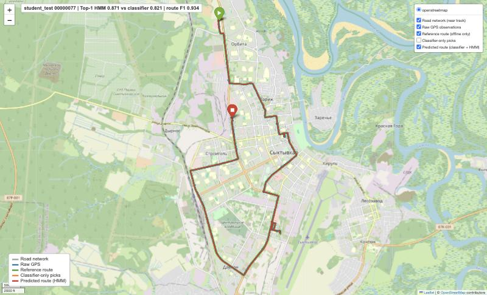

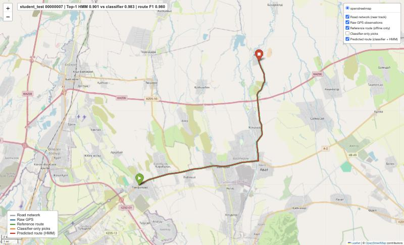

Interactive maps in the repository: `maps/student_test_00000052.html`, `…00000040.html`, `…00000077.html`, `…00000007.html` and `maps/eda_train_00000001.html` (raw data with the reference route).

# 7. API, UI and deployment

| | Laptop 1: model and API (backend) | Laptop 2: user interface |
|---|---|---|
| Software | FastAPI + uvicorn (`api/main.py`) | Static web page with Leaflet (`ui/index.html`) |
| Holds | Tuned HistGB, HMM configuration, road networks, the evaluation trips, and the reference routes for server-side scoring | Nothing but the page |
| Started with | `HOST=0.0.0.0 scripts/demo_api.sh` (VS Code terminal) | `scripts/demo_ui.sh http://<laptop-1-ip>:8000` |

**API endpoints:** `GET /health` (model, HMM parameters, number of trips), `GET /trips` (the evaluation trip ids), and `POST /predict {"trip_id": "00000015"}`. The predict endpoint returns the predicted arc per observation, the reconstructed route and its GeoJSON geometry, the raw GPS, aggregate metrics and timings. Invalid ids return 422 and unknown trips 404.

**Ground truth stays on the server.** Inference loads the trip **without** the `.route` file. After the prediction is complete, the server reads `.route` to compute aggregate metrics (Top-1, continuity, route precision/recall/F1, edit distance). Responses never contain reference arcs or geometry. This is enforced by 17 automated tests (`tests/test_api.py`): the response fields are whitelisted, forbidden words are absent, and predictions are identical when the `.route` file is deleted. Every request is logged to the console of Laptop 1 with the client IP, status, latency and metrics. Outputs are computed at request time; nothing is hard-coded.

**Working UI (evaluator trips, served from the API on Laptop 1):**

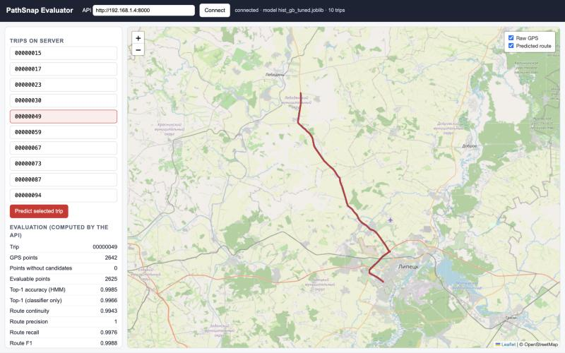

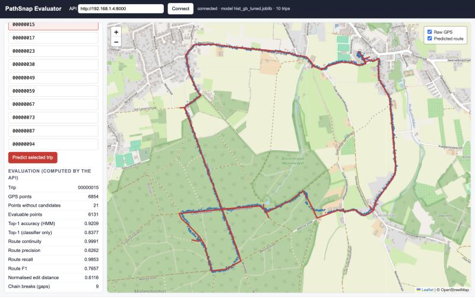

**Successful API responses in the terminal of the receiving laptop (Laptop 1, VS Code).** The log shows `POST /predict` requests arriving **from Laptop 2 (10.20.200.240)**, each answered with HTTP 200, and the server-side metrics for trip 00000015:

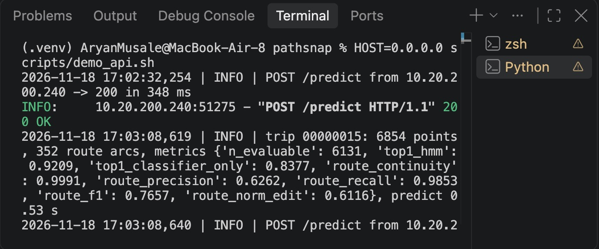

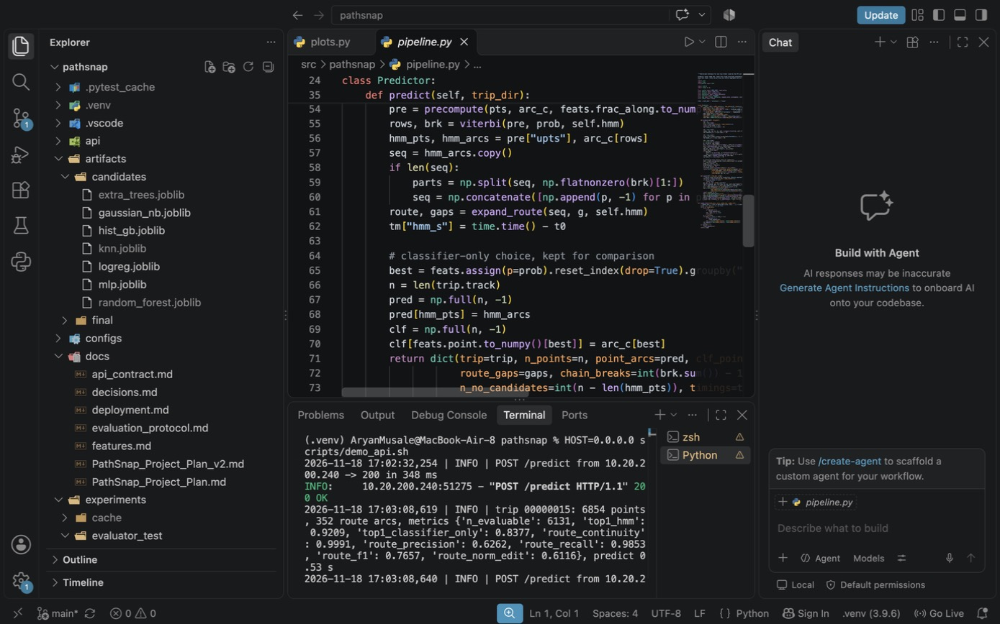

**Performance.** Cold start (loading the model) takes 0.15 s. A prediction takes 0.1–0.9 s per trip end-to-end (feature extraction, model, HMM, route reconstruction and scoring). All ten evaluator trips were served successfully.

# 8. Final evaluation on the evaluator-test trips

The final pipeline (tuned HistGB + HMM, configuration fixed beforehand) was run **once** on the ten evaluator trips (17,899 evaluable points). Nothing was fitted, tuned or selected on this data. For reporting only, the untuned HistGB was also passed through the identical pipeline; the final model was not changed afterwards.

| Pipeline | Top-1, classifier only | Top-1, with HMM | Route F1 | Continuity | Route precision / recall |
|---|---|---|---|---|---|
| **Final: tuned HistGB + HMM** | 0.9279 | **0.9616** | **0.953** | 0.967 | 0.921 / 0.994 |
| Reference: untuned HistGB + HMM | 0.9475 | 0.9616 | 0.941 | – | – |

| Trip | Evaluable | Top-1 classifier | Top-1 HMM | Route F1 | Edit dist. |
|---|---|---|---|---|---|
| 00000015 | 6131 | 0.838 | 0.921 | 0.766 | 0.612 |
| 00000017 | 1301 | 0.957 | 0.972 | 0.953 | 0.087 |
| 00000023 | 449 | 0.953 | 0.982 | 0.922 | 0.169 |
| 00000030 | 610 | 0.856 | 0.895 | 0.954 | 0.091 |
| 00000049 | 2625 | 0.997 | 0.999 | 0.999 | 0.002 |
| 00000059 | 1003 | 0.979 | 0.989 | 0.971 | 0.083 |
| 00000067 | 711 | 0.990 | 0.990 | 0.988 | 0.012 |
| 00000073 | 1127 | 0.991 | 0.991 | 0.996 | 0.036 |
| 00000087 | 1386 | 0.968 | 0.998 | 0.999 | 0.002 |
| 00000094 | 2556 | 0.984 | 0.977 | 0.983 | 0.130 |

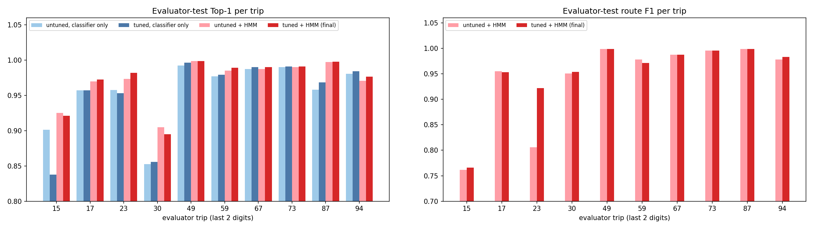

**Findings.**

1. **The HMM is the main gain on unseen data:** Top-1 0.928 → **0.962** (+3.4 points). It improved 7 of 10 trips, left 2 unchanged and slightly lowered 1 (trip 94).
2. **The tuning gain did not transfer to the classifier alone.** Tuned 0.928 vs untuned 0.948. Almost all of the gap is trip 00000015, which holds 34 % of the evaluable points and where the tuned classifier drops from 0.901 to 0.838. The larger tuned model (239 leaves, minimum leaf 14) fits the training trips more closely and generalises less well to this unusual trip.
3. **With the HMM both versions reach the same Top-1 (0.9616)**, and the tuned pipeline has the better route F1 (0.953 vs 0.941): the decoder absorbs most per-point errors.
4. **Trip 00000015 remains the hardest route** (route F1 0.77 despite Top-1 0.92), because of extra detours inserted between consecutive chosen arcs.
5. **Results are consistent across partitions:** CV, student-test and evaluator-test give the same ranking of approaches (rule < classifier < classifier + HMM).

# 9. Limitations and future work

- **Derived labels.** Per-point labels come from our own alignment of GPS to the reference route; 9–18 % of points are excluded as ambiguous, and the 30 m ambiguity threshold has not had a sensitivity analysis. The reference routes are not guaranteed error-free.
- **HMM failure at forks** (student-test trip 7, evaluator trip 94): add heading agreement to the transition model, or weight emissions more strongly near forks.
- **Route detours** (evaluator trip 15): penalise long inserted paths during route reconstruction.
- **Tuning generalisation:** the tuned model generalised worse on one unusual evaluator trip; a regularisation constraint in the search space (e.g. a larger minimum leaf size) would be more robust.
- **Environment:** LightGBM/XGBoost could not run on our machine (missing `libomp`), so boosting is represented by scikit-learn's HistGradientBoosting. KNN and the MLP were trained on subsamples for run-time reasons.

# 10. Reproducibility, repository and AI-use disclosure

**Repository:** https://github.com/Musaleee/PathSnap-ML-Hackathon

| Folder / file | Contents |
|---|---|
| `src/pathsnap/` | Data loading and checks (`data_io`, `eda`), projection (`geo`), label alignment (`labels`), candidates, features, dataset, models, training and evaluation, Bayesian tuning (`tuning`), HMM (`hmm`, `hmm_experiment`), inference pipeline, Folium maps (`viz`), report figures and tables |
| `api/`, `ui/`, `tests/`, `scripts/` | FastAPI backend, evaluator UI, API and leak tests, demo start scripts |
| `artifacts/final/` | Tuned model (`hist_gb_tuned.joblib`), model configuration, HMM configuration |
| `artifacts/candidates/` | The compared models (the three largest are rebuilt with `python -m pathsnap.train`) |
| `experiments/` | One JSON log per run, result CSVs, the Optuna study and trials, the evaluator-test runs |
| `maps/`, `reports/` | Interactive Folium maps, figures, generated result tables, this report |
| `README.md`, `RUN_LOCALLY.md`, `DEMO.md`, `docs/` | Installation, execution, two-laptop deployment, API contract, decision log |

Every number in this report comes from a logged run in the repository; `python -m pathsnap.report_tables` regenerates the result tables from those logs. Environment: Python 3.9.6, scikit-learn 1.6.1, Optuna 5.0.0, FastAPI 0.115.6, on a 10-core laptop with 16 GB RAM.

**AI-use disclosure.** The team used an AI assistant (Claude, by Anthropic) to help draft the project plan, the source code (data processing, features, model training, Bayesian optimisation, HMM, API, UI, maps and figures) and the text of this report. All experiments were run by the team on the team's machines, all reported results come from those runs, and the team reviewed the code and results and is responsible for them. Writing the report with AI assistance was permitted by our course instructor.
